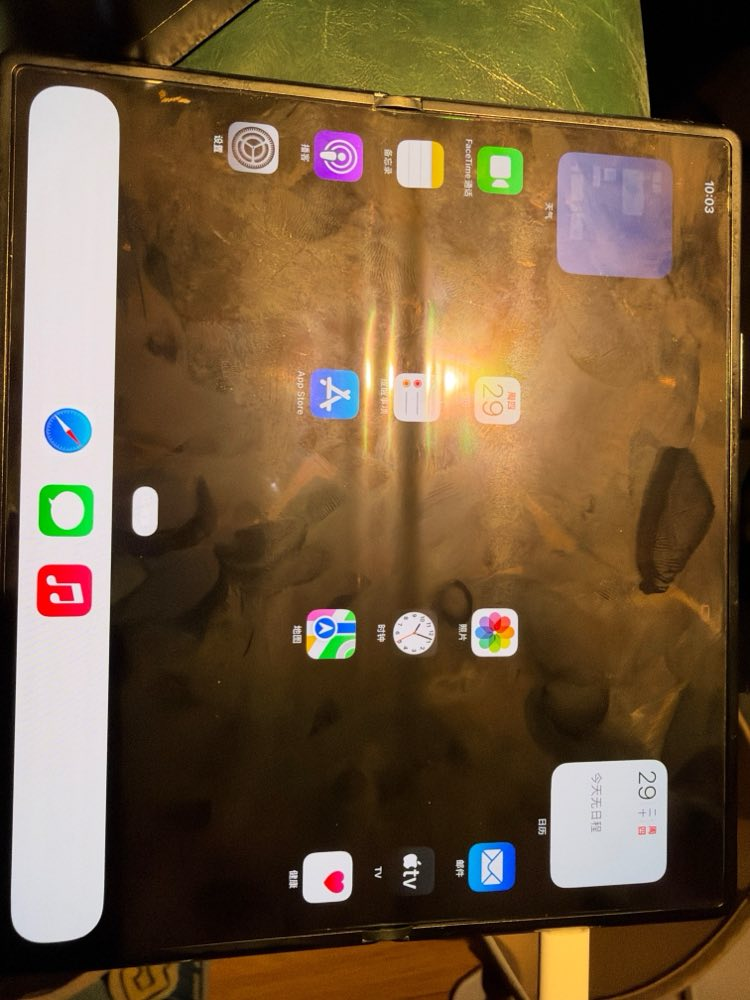

# UniXNU-zizhan

**简体中文** | [English](README_EN.md)

小米 MIX Fold 2（zizhan，Qualcomm SM8475）的 [UniXNU](https://github.com/UniXNU/UniXNU) 格式 2 设备仓库，目标系统是 **iPadOS 18.7.10（22H374）**，内核为 Darwin 24.6.0 / XNU 11417.140.69，系统镜像输入取自 iPad7,11（J171AP），默认运行时 ADT 身份为 **iPad7,12**。

本仓库从 Nothing Phone (2) 的 [UniXNU-pong](https://github.com/Chengdong-Yu/UniXNU-pong) 派生，保留了它的完整提交历史。两台手机都是 SM8475，所以 SoC 层、PongPlatform24 组件和大部分驱动直接沿用；zizhan 的改动在 pong `64ddf28` 之后的提交里。

- 固件：[uefi-zizhan](https://github.com/qiumochen/uefi-zizhan)（uefi-pong 加 `Platforms/Xiaomi/zizhanPkg`）
- 面向用户：[功能适配清单](docs/FEATURES.zh.md)（只看哪些能用、有哪些限制、哪些尚未确认）
- 当前台账：[当前进度与接续入口](docs/progress/STATUS.md)
- 结构化移植记录：[porting.toml](porting.toml)
- 开发交接与 Mac 配置：[CLAUDE.md](CLAUDE.md)
- 开发记录：[docs/progress/](docs/progress/)（按日期，含每一轮的配置、结果和根因）



## 进度（截至 2026-11-28）

| 部分 | 状态 |
| --- | --- |
| 启动 | `fastboot boot` 临时引导 UEFI → UniXNU 菜单（默认标题 `iPadOS 18 (zizhan)`）→ DarwinBoot24 → XNU，**默认不写任何分区**，每轮结束自动回 Android；`ci_boot_ufs.sh` 默认把板级附加参数装入 `/chosen zizhan-boot-args`，使内核命令行保持在 1020 字节以内；独立双启动候选镜像（`check-m3-standalone.py`）已完成离线与原厂备份校验，待在场 RAM 预演 |
| CPU / 内存 | 8 核（4×A510、3×A710、1×X2）AMP 运行，频率上限对齐本机 2.02 / 2.75 / 3.00 GHz，UI 线程优先用 X2；关闭 DEVELOPMENT 调度与 UPL 调试热点（0045，SpringBoard 运行队列等待降低 32.7%）；受管内存 9728 MiB |
| 存储 / 应用生态 | 支持 Android `/data` 内非破坏性连续根镜像（原 `19.4 GiB` 保底镜像与扩展 **`64 GiB` 根卷 / `48 GiB` Data** 并存）；修复 APFS 挂根死锁（0006）与 `minisandbox` 扩展令牌（0040）；内置原生 **`IPA 安装器` v2**（`:8088` 网页 `<=12 GiB` 流式直装已脱壳 `4K/16K` IPA，自动拒绝 `cryptid=1` FairPlay 加密包）及第三方沙盒 8 维兼容（全局 Turnip Metal、Keychain `-34018` 文件回退、AppGroup、`9:16` 居中手机视口、CoreImage 软回退，`ZizhanCompatSuite` 8/8 通过） |
| 显示 / 外屏 | 内屏 2160×1916、120 Hz DPU 零拷贝（128 MiB 面板池 6 零拷贝槽位），默认开启真实 L18 DCS 背光与环境光自动调光，支持 `0°/90°/180°/270°` 四向零拷贝旋转；合盖默认切换外屏时钟并支持上滑/双击进入 `2:1` 或 `1:1` 满高（`1080×1916` + `ZOOM` 胶囊）外屏桌面及 ST FTM5 触控（含口袋近距防误触）；合盖初始锁屏复位、外屏强制竖屏与外屏实体电源键待修（`video-7` 记录） |
| 触摸 / 输入 | 内屏 ST FTS（GPIO 模拟 SPI）点按、滑动正常；`iPad7,12` 身份下原生中英文（拼音）键盘可用；熄屏自动停扫内屏触控并放宽按键轮询（0042）；实体音量键支持单步防连跳节流（0044） |
| GPU | Adreno 730（Turnip + metal2vulkan），768 MiB BO 池，WebKit GPU 进程 256 MiB 地址窗口，ASTC 与第三方容器 `pong_metal_global=1` 默认开启；修复 22H374 横竖屏旋转错位与 0045 调度开销后缩放动画约 58 fps、主屏落定 95.7 fps；壁纸扩展默认禁用 GPU，不宣称全局 120 fps |
| 电池 / 深睡 / 温控 | ADSP + PMIC GLINK 实时上报双电芯电压、健康度（SOH）、循环次数与瓦数，设置电池页默认双开关清爽布局（百分比 + 低电量模式）；**默认开启平台级熄屏深睡**（`IOPMrootDomain` + CPU 1–7 PSCI `CPU_OFF` + CPU 0 WFI + 外屏 `DSI1` 断电 + Adreno DDR 释放 + `zizhan_standby_bw=3` 总线降票 + Wi-Fi 省电，**纯电池熄屏降至 `-219 mA / 952 mW`、稳态底噪 `730 mW`**，25+ 轮唤醒零 panic）；默认双组 TSENS 逐级温控（CPU 90 °C / GPU 85 °C）与北京时间（`Asia/Shanghai`） |
| 音频 / 麦 / 触感 | 默认装载 CoreAudio `ZizhanAudio.driver` HAL（AudioReach + 双 CS35L41 `400 kHz` 突发加载 + `VoiceChat` 顶部 `0x40` 听筒路由 + WCD9385 主麦物理录音）与 PM8350B X 轴线性马达驱动；无人值守启动默认保持静音/静振（`zizhan_pulse_dry=1 zizhan_haptics_dry=1`），`ZIZHAN_USER_PRESENT=yes` 在场启动开启真实外放与线性马达（待集中终验） |
| Wi-Fi | 默认随 GPU 一并开启。原生 Settings 选网、保存凭据自动入网、WPA2/DHCP/HTTPS、2.4↔5 GHz 跨频段重连及跨多轮平台深睡/唤醒保持关联已通过；不同子网与长时间多网漫游待验收 |
| 蓝牙 | 默认以 **`3 Mbps` 高速串口**开启（QCA6490 SE20 UART，`552 ms` 下载补丁 + `VIRT` H4 桥 + `/pong/bt.dylib` + 配对目录持久化）；设置页面可开启蓝牙并扫描附近设备，手动配对与蓝牙音频待在场验证 |
| 传感器 | 本地固件存在时默认开启 SLPI 7 传感器协处理器（`zizhan_slpi=4`：52 Hz 加速度计/陀螺仪四向旋转、磁力计、气压计、环境光自动调光、外屏近距防误触与 `hinge_angle` 铰链合盖联动），熄屏自动静默省电、亮屏恢复 |
| 相机 / 定位 / 蜂窝 | 第三方容器 `AVCaptureSession` 已跑通 `960×720` 三摄出流（后摄 `OV13B10` / 前摄 `IMX596` + `DW9800V` 对焦 + `RumbaS4H` OIS，按需上电、退出 `3.5 s` 零功耗下电），传感器安装角旋转与降噪/色彩校正待修，原厂 `Camera.app` 暂不支持；基带锁定离线无射频模式，可选 `zizhan_gnss=2` 输出 1 Hz `QMI_LOC` GPS 至 `CoreLocation`（户外搜星待在场验证，蜂窝数据未启用） |

## 与 Pong 的硬件差异

| | Pong | zizhan |
| --- | --- | --- |
| 内屏 | 1080×2412 | 2160×1916 命令模式 DSC，60/120 Hz（另有 1080×2520 外屏） |
| 触摸 | Goodix Berlin-D | 内屏 ST FTS（`fts-pri`，SPI0；SE4 只能给 GSI 用），外屏 ST FTM5（`fts-sec`，SPI2） |
| DRAM 第二段 | 0xf1400000 + 0xec00000 | 0xf4600000 + 0xba00000 |
| ADSP carveout | 0x85700000 + 0x2800000 | 0x9fd00000 + 0x3100000 |
| 电池属性编号 | QTI 标准 | 小米：12 之后后移一位 |
| 功放 | 2×TFA9873 | 2×CS35L41 |

## 构建

构建机是 Apple silicon 的 Mac（完整 Xcode、Homebrew 的 llvm@18、lld、dtc、Python 3.12）。实际使用的流水线在 [`tools/zizhan/mac/`](tools/zizhan/mac/)，所有脚本都从环境变量 `ZIZHAN_SRC`（默认 `~/zizhan`）找工作目录：

```text
$ZIZHAN_SRC/
  UniXNU-zizhan/   本仓库
  uefi-zizhan/     固件仓库（带子模块）
  UniXNU-pin/      UniXNU 0fc0fc1f9ddd0fbd4787738afef38667df5e0a95（脚本会自动拉取）
  sheng/           UniXNU-sheng 08cde20（ci_prep.sh 会自动拉取）
  work/  out/  logs/  venv/
```

| 步骤 | 脚本 |
| --- | --- |
| 固件 FD 与 UEFI 启动镜像 | `build_fw.sh`，`build_bootimg.py` → `out/zizhan-uefi.img` |
| 依赖（sheng、Apple 开源源码、DarwinBoot24） | `ci_prep.sh` |
| 内核 | `DEFCONFIG=zizhan_ipados18_gpu_defconfig ci_kernel.sh` |
| 用户态镜像和根镜像安装 | `userland/build-ipados18.py`（见 [migration/ipados18](migration/ipados18/README.zh.md)）、`os-trial-edit.py`、`install_pinned.py` |
| 启动镜像 | `PROFILE=zizhan_ipados18_gpu ci_boot_ufs.sh NAME <根镜像 4K 块号>` |
| 上机一轮（无人值守） | `zround.sh` / `cycle.sh IMG RUN`：启动 → 看门狗复位回 fastboot → RamoopsDump 写 logfs → 回到 Android 取回日志 |
| 局部刷新 | `metal-refresh.sh`、`ui-refresh.sh`、`fw-refresh.sh`（只重写根镜像里的 OS 窗口） |
| 编译 + 打包 + 上机一轮 | `round.sh RUN [内核参数…]`（默认带电池与日用配置；等待时间按 `pong_autoreset` 算） |
| 轮次中断 / 手机掉线后收尾 | `cycle-resume.sh IMG RUN`（只做取日志的后半段）、`when-back.sh RUN [参数…]`（等手机重新出现再接着跑） |
| 从现有镜像去掉 launchd 任务 | `jobs-refresh.sh TAG LABEL…`（与 `userland/build-ipados18.py` 的 `EXCLUDED18` 对应） |
| 诊断 | `zlog.py`（整轮日志与功耗汇总）、`zoom-cadence.py`（四阶段帧率与栅栏分析）、`gsym.py` / `dscsym.py`（内核与共享缓存符号化）、`settings-ui.py` |

日常内核 / 驱动开发在本机完成精简 CI 和完整设备两套配置构建；GitHub Actions 按以下方式补充检查：

| 工作流 | 触发方式 |
| --- | --- |
| `Porting record` | 每次 push / PR 检查结构与增量区域覆盖，包括纯文档提交。 |
| 显示、Wi-Fi、日用主机回归 | 相关源码、测试、工作流或公共依赖变化时自动运行，也可手动运行；纯文档修改不触发。 |
| `zizhan macOS build` | 仅手动运行。`task=kernel` 编译内核；`task=disk-probe` 单独诊断 runner 磁盘与工具，两者不同时启动。 |

公共配置、设备树、格式 2 层、源码固定版本、`scripts/` 或 XNU 补丁变化会触发三组主机回归。阶段性发布、工具链 / 构建脚本变更，或需要检查干净环境可重建性时，在 Actions 页面选择 `zizhan macOS build` → `Run workflow` → `task=kernel`；排查 runner 环境时选 `disk-probe`。命令行入口：

```bash
gh workflow run macos-build.yml -f task=kernel
gh workflow run macos-build.yml -f task=disk-probe
```

手动内核构建默认仍关闭 Wi-Fi、Adreno 和背光；可选固件、IPSW 输入保留，磁盘诊断不使用这些输入。主机回归和云端构建不能代替完整设备配置或真机验收。触发策略与验证范围见 [CI 效率调整](docs/progress/2026-11-07-ci-efficiency.md)。

仓库已被上游目录收录；统一 `scripts/package.sh` 与 22H374 配置映射已加入，package action 仍待上游支持 Darwin24/UFS 构建入口，见 [打包接入进展](docs/progress/2026-11-06-boot-release-followup.md#release-01)。

## 私有输入

仓库只有源码、补丁、配置和脚本。以下内容需要在本机准备，**不要提交**：

- Apple 的 22H374 restore 及从中提取的组件（[proprietary-files.txt](proprietary-files.txt)）；
- 手机自带的固件与板级文件：Adreno 730 的 `a730_sqe.fw`、`gmu_gen70000.bin`、`a730_zap.*`；ADSP / SLPI / MPSS 固件（用 `tools/zizhan/mdt2mbn.py` 合并）及传感器校准种子（用 `tools/zizhan/mac/sensors-fs-pack.py` 打包）；
- 用户态镜像、根镜像、分区备份。

## 风险

- 动手之前先完整备份全部分区。本仓库默认流程只用 `fastboot boot`，根镜像放在 `/data` 的一个连续文件里，但 bootloader 必须解锁，且需要 root。
- 日用配置默认开启 TSENS 逐级温控（CPU 90 °C / GPU 85 °C）；若以 `zizhan_daily=0` 关闭温控或连续跑高负载试验仍会明显发热，`cycle.sh` 每轮之前会等待电池降温。

## 致谢与许可证

- [UniXNU](https://github.com/UniXNU/UniXNU) 及其组件；
- [UniXNU-pong](https://github.com/Chengdong-Yu/UniXNU-pong) 与 [uefi-pong](https://github.com/Chengdong-Yu/uefi-pong)（Chengdong-Yu）：本仓库的基础；
- [UniXNU-sheng](https://github.com/UniXNU/UniXNU-sheng)：电池协议、复位和超时设置的参考。

设备级代码采用 BSD-2-Clause-Patent（[LICENSE](LICENSE)）；导入的组件保留各自的许可证和 SPDX 标记，见 [THIRD_PARTY_NOTICES.md](THIRD_PARTY_NOTICES.md)。

本项目与 Apple、小米和 Nothing 无关。
