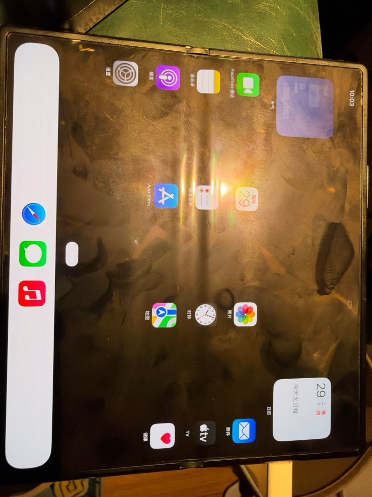

# UniXNU-zizhan

**简体中文** | [English](README_EN.md)

小米 MIX Fold 2（zizhan，Qualcomm SM8475）的 [UniXNU](https://github.com/UniXNU/UniXNU) 格式 2 设备仓库，目标系统是 **iPadOS 18.7.10（22H374）**，内核为 Darwin 24.6.0 / XNU 11417.140.69，系统输入用 iPad7,11（J171AP）。

本仓库从 Nothing Phone (2) 的 [UniXNU-pong](https://github.com/Chengdong-Yu/UniXNU-pong) 派生，保留了它的完整提交历史。两台手机都是 SM8475，所以 SoC 层、PongPlatform24 组件和大部分驱动直接沿用；zizhan 的改动在 pong `64ddf28` 之后的提交里。

- 固件：[uefi-zizhan](https://github.com/qiumochen/uefi-zizhan)（uefi-pong 加 `Platforms/Xiaomi/zizhanPkg`）
- 结构化移植记录：[porting.toml](porting.toml)
- 开发交接与 Mac 配置：[CLAUDE.md](CLAUDE.md)（含最新 GPU WIP 与待验证项）
- 开发记录：[docs/progress/](docs/progress/)（按日期，含每一轮的配置、结果和根因）



## 进度

| 部分 | 状态 |
| --- | --- |
| 启动 | `fastboot boot` 临时引导 UEFI → UniXNU 菜单 → DarwinBoot24 → XNU，**不写任何分区**，每轮结束都回到 Android |
| CPU / 内存 | 8 核（4×A510、3×A710、1×X2）以 AMP 方式运行，UI 线程优先用 X2；受管内存 9728 MiB |
| 存储 | 根镜像是 Android `/data` 里一个物理连续的 19.4 GiB 文件，含 OS、SystemOS 和可写 Data 三个卷；修好了一个概率性的 APFS 挂根死锁（0006） |
| 显示 | 内屏 2160×1916 显示 iPadOS 主屏，面板切到 120 Hz，DPU 直接翻页（零拷贝三缓冲）；外屏未驱动，亮度不可调 |
| 触摸 | 内屏 ST FTS（GPIO 模拟 SPI），能点开应用、滑动；外屏触摸未驱动 |
| GPU | Adreno 730，Turnip + metal2vulkan；g298 修正 UIKit 类名后，合成滑动 moving 95.3 fps（同条件基线 56.7–58.4），首帧仍约 75–80 ms；壁纸扩展默认不能使用 GPU，不能宣称全局 120 fps |
| 电池 | ADSP 启动，经 PMIC GLINK 读到电池，读数与 Android 一致；状态栏与充电拔插已确认，设置电池页能打开；健康度仍转圈 |
| 按键 | 长按电源键 3 秒热复位回 fastboot；其他按键未核对 |
| Wi-Fi | QCA6490 试验配置已验证扫描、WPA2、DHCP、主动续租及同网重连 HTTPS 200；默认关闭。Settings 原生入网、跨 AP DHCP 与跨频段重连尚未通过 |
| 蜂窝 / 音频 | 蜂窝未实现；CS35L41 功放尚未接入，与 Pong 的 TFA9873 不同 |

## 与 Pong 的硬件差异

| | Pong | zizhan |
| --- | --- | --- |
| 内屏 | 1080×2412 | 2160×1916 命令模式 DSC，60/120 Hz（另有 1080×2520 外屏） |
| 触摸 | Goodix Berlin-D | ST FTS（`fts-pri`，SPI0；SE4 只能给 GSI 用） |
| DRAM 第二段 | 0xf1400000 + 0xec00000 | 0xf4600000 + 0xba00000 |
| ADSP carveout | 0x85700000 + 0x2800000 | 0x9fd00000 + 0x3100000 |
| 电池属性编号 | QTI 标准 | 小米：12 之后后移一位 |
| 功放 | 2×TFA9873 | 2×CS35L41 |

## 构建

构建机是 Apple silicon 的 Mac（完整 Xcode、Homebrew 的 llvm@18、lld、dtc、Python 3.12）。实际使用的流水线在 [`tools/zizhan/mac/`](tools/zizhan/mac/)，所有脚本都从环境变量 `ZIZHAN_SRC`（默认 `~/zizhan`）找工作目录：

```text
$ZIZHAN_SRC/
  UniXNU-zizhan/   本仓库
  uefi-zizhan/     固件仓库（带子模块）
  UniXNU-pin/      UniXNU 0fc0fc1f9ddd0fbd4787738afef38667df5e0a95（脚本会自动拉取）
  sheng/           UniXNU-sheng 08cde20（ci_prep.sh 会自动拉取）
  work/  out/  logs/  venv/
```

| 步骤 | 脚本 |
| --- | --- |
| 固件 FD 与 UEFI 启动镜像 | `build_fw.sh`，`build_bootimg.py` → `out/zizhan-uefi.img` |
| 依赖（sheng、Apple 开源源码、DarwinBoot24） | `ci_prep.sh` |
| 内核 | `DEFCONFIG=zizhan_ipados18_gpu_defconfig ci_kernel.sh` |
| 用户态镜像和根镜像安装 | `userland/build-ipados18.py`（见 [migration/ipados18](migration/ipados18/README.zh.md)），`install_pinned.py` |
| 启动镜像 | `PROFILE=zizhan_ipados18_gpu ci_boot_ufs.sh NAME <根镜像 4K 块号>` |
| 上机一轮（无人值守） | `cycle.sh IMG RUN`：启动 → 看门狗复位回 fastboot → RamoopsDump 写 logfs → 回到 Android 取回日志 |
| 局部刷新 | `metal-refresh.sh`、`ui-refresh.sh`、`fw-refresh.sh`（只重写根镜像里的 OS 窗口） |
| 编译 + 打包 + 上机一轮 | `round.sh RUN [内核参数…]`（`ADSP=2` 带电池；等待时间按 `pong_autoreset` 算） |
| 轮次中断 / 手机掉线后收尾 | `cycle-resume.sh IMG RUN`（只做取日志的后半段）、`when-back.sh RUN [参数…]`（等手机重新出现再接着跑） |
| 从现有镜像去掉 launchd 任务 | `jobs-refresh.sh TAG LABEL…`（与 `userland/build-ipados18.py` 的 `EXCLUDED18` 对应） |
| 诊断 | `gsym.py LOG 手势号 [TID…] --bin 二进制`（采样器 `gs_all=2` 的整条栈）、`settings-ui.py LOG`（带 `pong_url` 的轮里设置界面的打印） |

`.github/workflows/macos-build.yml` 沿用 UniXNU-pong 的 GitHub Actions 内核构建，用法见 [UniXNU-pong 的 README](https://github.com/Chengdong-Yu/UniXNU-pong#用-github-actions-编译内核)。

`Porting record` 检查结构与 push/PR 增量区域覆盖；`Wi-Fi host regressions` 在无固件、无凭据环境回放 SMMU、WMI、DHCP 和 USB 失败路径。默认 macOS CI 关闭 Wi-Fi、Adreno 和背光，不能代替完整配置或真机验收。仓库已被上游目录收录；最新统一 `scripts/package.sh` / package action 尚待迁移，见 [规范核对与待办](docs/progress/2026-11-04-upstream-ci-audit.md)。

## 私有输入

仓库只有源码、补丁、配置和脚本。以下内容需要在本机准备，**不要提交**：

- Apple 的 22H374 restore 及从中提取的组件（[proprietary-files.txt](proprietary-files.txt)）；
- 手机自带的固件：Adreno 730 的 `a730_sqe.fw`、`gmu_gen70000.bin`、`a730_zap.*`；ADSP 的 `adsp.mdt` 与 `b00..b25`（用 `tools/zizhan/mdt2mbn.py` 合并）；
- 用户态镜像、根镜像、分区备份。

## 风险

- 动手之前先完整备份全部分区。本仓库的流程只用 `fastboot boot`，根镜像放在 `/data` 的一个文件里，但 bootloader 必须解锁，且需要 root。
- 没有温控。连续多轮会让手机明显发热，`cycle.sh` 每轮之前会等电池降到 35 °C。

## 致谢与许可证

- [UniXNU](https://github.com/UniXNU/UniXNU) 及其组件；
- [UniXNU-pong](https://github.com/Chengdong-Yu/UniXNU-pong) 与 [uefi-pong](https://github.com/Chengdong-Yu/uefi-pong)（Chengdong-Yu）：本仓库的基础；
- [UniXNU-sheng](https://github.com/UniXNU/UniXNU-sheng)：电池协议、复位和超时设置的参考。

设备级代码采用 BSD-2-Clause-Patent（[LICENSE](LICENSE)）；导入的组件保留各自的许可证和 SPDX 标记，见 [THIRD_PARTY_NOTICES.md](THIRD_PARTY_NOTICES.md)。

本项目与 Apple、小米和 Nothing 无关。
