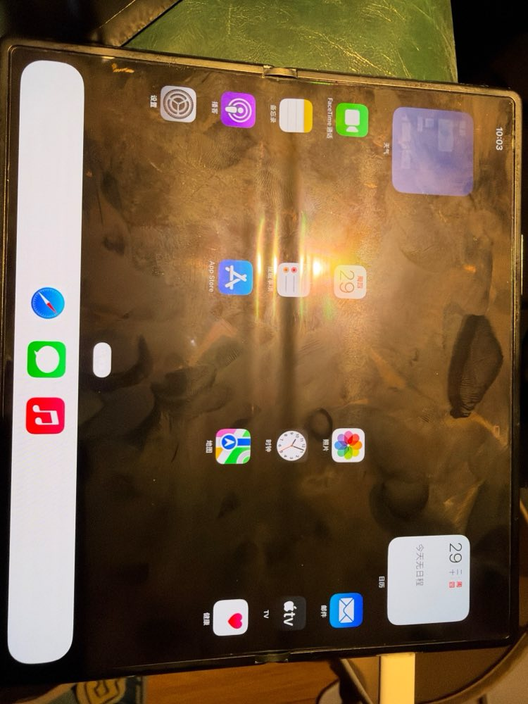

# UniXNU-zizhan

[简体中文](README.md) | **English**

A [UniXNU](https://github.com/UniXNU/UniXNU) format 2 device repository for the Xiaomi MIX Fold 2 (zizhan, Qualcomm SM8475). It targets **iPadOS 18.7.10 (22H374)** with Darwin 24.6.0 / XNU 11417.140.69, using iPad7,11 (J171AP) as the system restore input and **iPad7,12** as the default ADT runtime identity.

This repository is derived from [UniXNU-pong](https://github.com/Chengdong-Yu/UniXNU-pong) for the Nothing Phone (2) and keeps its full history. Both phones use the SM8475, so the SoC layer, the PongPlatform24 component and most drivers are reused. The zizhan changes are the commits after pong `64ddf28`.

- Firmware: [uefi-zizhan](https://github.com/qiumochen/uefi-zizhan) (uefi-pong plus `Platforms/Xiaomi/zizhanPkg`)
- User capability summary (Chinese): [docs/FEATURES.zh.md](docs/FEATURES.zh.md)
- Current ledger (Chinese): [docs/progress/STATUS.md](docs/progress/STATUS.md)
- Structured porting record: [porting.toml](porting.toml)
- Development notes (Chinese): [docs/progress/](docs/progress/), dated, with each run's configuration, result and root cause



## Status (as of 2026-11-28)

| Area | State |
| --- | --- |
| Boot | `fastboot boot` of UEFI -> UniXNU menu (`iPadOS 18 (zizhan)` by default) -> DarwinBoot24 -> XNU. **No partition is written**; every run returns to Android. `ci_boot_ufs.sh` packs board runtime switches into `/chosen zizhan-boot-args` to keep the DarwinBoot command line below 1020 bytes. Standalone dual-boot image verification (`check-m3-standalone.py`) passes offline checks against stock backups, pending attended RAM rehearsal |
| CPU / memory | 8 cores (4xA510, 3xA710, 1xX2) as an AMP machine with zizhan frequency caps (2.02 / 2.75 / 3.00 GHz), UI threads prefer the X2, and DEVELOPMENT sched-hygiene / UPL debug hot paths are disabled by default (patch 0045, cutting SpringBoard runnable wait by 32.7%); 9728 MiB managed |
| Storage / apps | Supports non-destructive contiguous root files in Android `/data` (retaining the 19.4 GiB rollback root alongside an expanded **64 GiB root / 48 GiB Data** volume). Fixes APFS root-mount deadlock (0006) and `minisandbox` extension tokens (0040); ships **`ZizhanInstaller` v2** (`:8088` HTTP `<=12 GiB` streaming sideloader for decrypted `4K/16K` IPAs, rejecting FairPlay `cryptid=1` packages) and 8-dimension third-party sandbox compatibility (`pong_metal_global=1`, Keychain `-34018` file fallback, AppGroup, centered `9:16` phone viewport, CoreImage SW fallback; `ZizhanCompatSuite` 8/8 PASS) |
| Display / cover | 2160x1916 inner panel at 120 Hz, DPU zero-copy scanout (6 canvas slots), real L18 DCS brightness + ALS auto-brightness, and 4-way (`0/90/180/270` deg) zero-copy rotation. Closing the fold switches to the outer cover clock and supports swipe/double-tap wake into `2:1` or `1:1` full-height (`1080x1916` + `ZOOM` pill) cover desktop with ST FTM5 touch and proximity pocket-guard; folded lock-screen entry, outer portrait lock and outer physical power key remain open (`video-7`) |
| Touch / input | Inner ST FTS over GPIO bit-banged SPI: tapping, scrolling and native Chinese/English keyboards work on `iPad7,12`; touch scan quiesces and SPMI button polling relaxes while screen is off (0042); physical volume keys have single-step pacing (0044) |
| GPU | Adreno 730 with Turnip and metal2vulkan, 768 MiB BO pool, 256 MiB WebKit GPU VA windows, ASTC and global third-party Metal (`pong_metal_global=1`) enabled by default; 22H374 landscape/portrait surface rotation and 0045 fastpath yield ~58 fps zoom animations and 95.7 fps `home_settle`; wallpaper GPU stays off, no global 120 fps claim |
| Battery / sleep / thermal | ADSP + PMIC GLINK reports dual-cell voltage, SOH, cycle count and Watts with a clean 2-switch Battery Settings page (`BATTERY_PERCENTAGE` + `LOW_POWER_MODE`). **Sub-1 W deep platform sleep is enabled by default** (`IOPMrootDomain` + PSCI `CPU_OFF` on CPUs 1..7 + masked WFI on CPU 0 + outer `DSI1` off + Adreno DDR release + `zizhan_standby_bw=3` bus floors + Wi-Fi 802.11 PS: **`-219 mA / 952 mW` pure-battery sleep, `730 mW` quiescent floor**, 25+ wake cycles with 0 panics), alongside two-bank TSENS step-throttling (90 C / 85 C) and `Asia/Shanghai` default timezone |
| Audio / mic / haptics | Enables CoreAudio `ZizhanAudio.driver` HAL by default when local CS35L41 blobs are present (AudioReach + dual CS35L41 `400 kHz` burst bring-up + top `0x40` earpiece VoiceChat routing + WCD9385 physical AMIC1 capture) plus PM8350B X-axis linear motor haptics; unattended boots stay silent/dry (`zizhan_pulse_dry=1 zizhan_haptics_dry=1`), while `ZIZHAN_USER_PRESENT=yes` enables speaker output and haptics (pending attended final check) |
| Wi-Fi | Enabled by default alongside GPU. Native Settings join, saved credentials, WPA2/DHCP/HTTPS, bidirectional 2.4<->5 GHz reconnects and retention across repeated deep platform sleep/wake cycles pass; different subnets and multi-hour roaming remain open |
| Bluetooth | Enabled by default at **3 Mbps** (`552 ms` rampatch download on QCA6490 SE20 UART + `VIRT` H4 bridge + `/pong/bt.dylib` + persistent `/private/var/MobileBluetooth` pairing directories). Settings scans nearby devices; manual pairing and audio await attended testing |
| Sensors | Enables the SLPI 7-sensor DSP by default when `sensors-fs.bin` is present (`zizhan_slpi=4`: 52 Hz accel/gyro 4-way rotation, mag, baro, ALS auto-brightness, cover proximity pocket guard and `hinge_angle` fold follow), quiescing streams on screen-off and resuming on wake |
| Camera / GNSS / cellular | Third-party containerized `AVCaptureSession` streams `960x720` across 3 logical cameras (rear `OV13B10` / front `IMX596` + `DW9800V` AF + `RumbaS4H` OIS, 0 mW rail teardown 3.5 s after close; sensor mount rotation and denoising/CCM remain open, stock `Camera.app` unsupported). MPSS stays offline (radio off); opt-in `zizhan_gnss=2` bridges 1 Hz `QMI_LOC` GPS to `CoreLocation` (outdoor fix pending; cellular data disabled) |

## Hardware differences from Pong

| | Pong | zizhan |
| --- | --- | --- |
| Inner panel | 1080x2412 | 2160x1916 command-mode DSC, 60/120 Hz (plus a 1080x2520 outer panel) |
| Touch | Goodix Berlin-D | Inner ST FTS (`fts-pri` on SPI0; SE4 is GSI-only), outer ST FTM5 (`fts-sec` on SPI2) |
| Second DRAM range | 0xf1400000 + 0xec00000 | 0xf4600000 + 0xba00000 |
| ADSP carveout | 0x85700000 + 0x2800000 | 0x9fd00000 + 0x3100000 |
| Battery property IDs | QTI standard | Xiaomi: shifted by one after 12 |
| Amplifiers | 2xTFA9873 | 2xCS35L41 |

## Build

The build host is an Apple silicon Mac with full Xcode, Homebrew llvm@18, lld, dtc and Python 3.12. The pipeline actually used is in [`tools/zizhan/mac/`](tools/zizhan/mac/); every script finds its work directory through `ZIZHAN_SRC` (default `~/zizhan`):

```text
$ZIZHAN_SRC/
  UniXNU-zizhan/   this repository
  uefi-zizhan/     firmware repository (with submodules)
  UniXNU-pin/      UniXNU 0fc0fc1f9ddd0fbd4787738afef38667df5e0a95 (fetched by the scripts)
  sheng/           UniXNU-sheng 08cde20 (fetched by ci_prep.sh)
  work/  out/  logs/  venv/
```

| Step | Script |
| --- | --- |
| Firmware FD and UEFI boot image | `build_fw.sh`, `build_bootimg.py` -> `out/zizhan-uefi.img` |
| Dependencies (sheng, Apple OSS sources, DarwinBoot24) | `ci_prep.sh` |
| Kernel | `DEFCONFIG=zizhan_ipados18_gpu_defconfig ci_kernel.sh` |
| Userland and root image install | `userland/build-ipados18.py` (see [migration/ipados18](migration/ipados18/README.zh.md)), `os-trial-edit.py`, `install_pinned.py` |
| Boot image | `PROFILE=zizhan_ipados18_gpu ci_boot_ufs.sh NAME <root image 4K block>` |
| One unattended device run | `zround.sh` / `cycle.sh IMG RUN`: boot -> watchdog reset to fastboot -> RamoopsDump to logfs -> back in Android, log fetched |
| Partial refresh | `metal-refresh.sh`, `ui-refresh.sh`, `fw-refresh.sh` (rewrite only the OS window of the root image) |
| Diagnostics | `zlog.py`, `zoom-cadence.py`, `gsym.py` / `dscsym.py`, `settings-ui.py` |

Local development builds both the reduced CI configuration and the full device configuration; GitHub Actions supplements those checks:

| Workflow | Trigger |
| --- | --- |
| `Porting record` | Runs on every push and PR to validate structure and changed-area coverage, including documentation-only commits. |
| Display, Wi-Fi and daily-use host regressions | Run automatically when relevant sources, tests, workflows or shared inputs change (or manually); skipped on documentation-only commits. |
| `zizhan macOS build` | Manual `workflow_dispatch` (`task=kernel` or `task=disk-probe`). Default cloud kernel builds disable Wi-Fi, Adreno and backlight and do not replace full local builds or hardware checks. |

The upstream catalog lists this repository. Unified `scripts/package.sh` and the 22H374 defconfig mapping are present; full package-action adoption awaits upstream Darwin24/UFS release support ([packaging follow-up](docs/progress/2026-11-06-boot-release-followup.md#release-01)).

## Private inputs

The repository holds source, patches, configuration and scripts only. Prepare these locally and **do not commit them**:

- Apple's 22H374 restore and the components extracted from it ([proprietary-files.txt](proprietary-files.txt));
- the phone's own firmware and board files: Adreno 730 `a730_sqe.fw`, `gmu_gen70000.bin`, `a730_zap.*`; ADSP / SLPI / MPSS images (merged by `tools/zizhan/mdt2mbn.py`) and sensor calibration seeds (`tools/zizhan/mac/sensors-fs-pack.py`);
- userland images, the root image and partition backups.

## Risks

- Back up every partition first. The default flow only uses `fastboot boot` and keeps the root in a contiguous file on `/data`, but it needs an unlocked bootloader and root.
- The daily profile enables two-bank TSENS step-throttling by default (CPU 90 C / GPU 85 C). Disabling it with `zizhan_daily=0` or running sustained stress rounds still heats the phone; `cycle.sh` waits for the battery to cool before starting the next run.

## Credits and license

- [UniXNU](https://github.com/UniXNU/UniXNU) and its components;
- [UniXNU-pong](https://github.com/Chengdong-Yu/UniXNU-pong) and [uefi-pong](https://github.com/Chengdong-Yu/uefi-pong) by Chengdong-Yu, the base of this port;
- [UniXNU-sheng](https://github.com/UniXNU/UniXNU-sheng), the reference for the battery protocol, reset and timeout settings.

Device-level code is BSD-2-Clause-Patent ([LICENSE](LICENSE)). Imported components keep their own licenses and SPDX identifiers; see [THIRD_PARTY_NOTICES.md](THIRD_PARTY_NOTICES.md).

This project is not affiliated with Apple, Xiaomi or Nothing.
