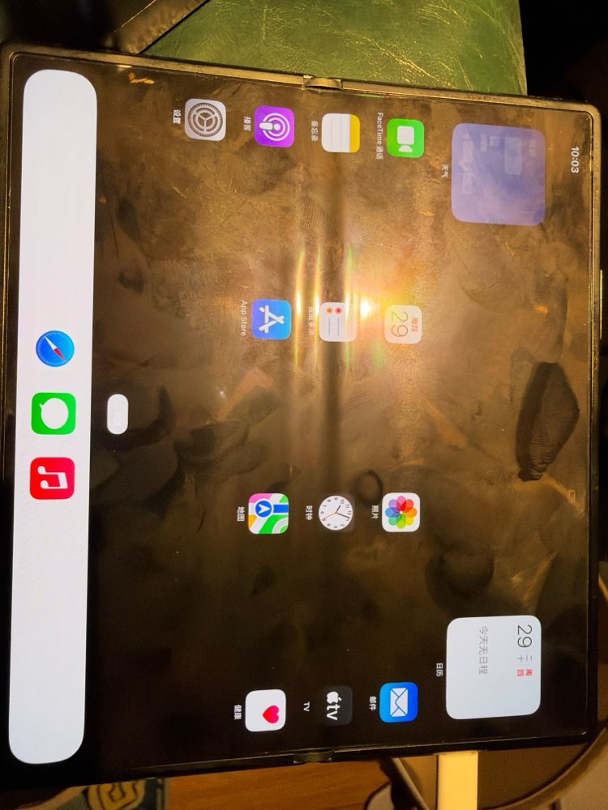

# UniXNU-zizhan

[简体中文](README.md) | **English**

A [UniXNU](https://github.com/UniXNU/UniXNU) format 2 device repository for the Xiaomi MIX Fold 2 (zizhan, Qualcomm SM8475). It targets **iPadOS 18.7.10 (22H374)** with Darwin 24.6.0 / XNU 11417.140.69 and iPad7,11 (J171AP) as the system input.

This repository is derived from [UniXNU-pong](https://github.com/Chengdong-Yu/UniXNU-pong) for the Nothing Phone (2) and keeps its full history. Both phones use the SM8475, so the SoC layer, the PongPlatform24 component and most drivers are reused. The zizhan changes are the commits after pong `64ddf28`.

- Firmware: [uefi-zizhan](https://github.com/qiumochen/uefi-zizhan) (uefi-pong plus `Platforms/Xiaomi/zizhanPkg`)
- Structured porting record: [porting.toml](porting.toml)
- Development notes (Chinese): [docs/progress/](docs/progress/), dated, with each run's configuration, result and root cause



## Status

| Area | State |
| --- | --- |
| Boot | `fastboot boot` of UEFI → UniXNU menu → DarwinBoot24 → XNU. **No partition is written**; every run returns to Android |
| CPU / memory | 8 cores (4×A510, 3×A710, 1×X2) as an AMP machine, UI threads prefer the X2; 9728 MiB managed |
| Storage | The root is a physically contiguous 19.4 GiB file in Android `/data` holding the OS, SystemOS and writable Data volumes. A probabilistic APFS root-mount deadlock is fixed (0006) |
| Display | iPadOS home screen on the 2160×1916 inner panel at 120 Hz, DPU flips CoreAnimation's own canvases (zero-copy triple buffering). Outer panel not driven, brightness fixed |
| Touch | Inner ST FTS over GPIO bit-banged SPI: tapping and scrolling work. Outer touch not driven |
| GPU | Adreno 730 with Turnip and metal2vulkan. Correct UIKit class matching in g298 yielded 95.3 moving fps in synthetic scrolling (56.7–58.4 baseline); first frame still about 75–80 ms. Wallpaper GPU access stays disabled; no global 120 fps claim |
| Battery | ADSP and PMIC GLINK readings match Android. Status bar and charging changes are confirmed; Settings Battery opens, but Battery Health still spins |
| Buttons | Holding power for 3 s warm-resets to fastboot; other keys not checked |
| Wi-Fi | Experimental QCA6490 config verifies native Settings selection/join, WPA2, DHCP and HTTPS 200; requested renewal, cleanup and distinct-BSSID reconnects pass in both 2.4↔5 GHz directions. Default GPU config keeps Wi-Fi off. Real MSI, natural T1 and different subnets remain unqualified; see the [latest record](docs/progress/2026-11-04-wifi-settings-and-roaming.md) |
| Cellular / audio | Cellular is unimplemented; CS35L41 amplifiers are not integrated (Pong uses TFA9873) |

## Hardware differences from Pong

| | Pong | zizhan |
| --- | --- | --- |
| Inner panel | 1080×2412 | 2160×1916 command-mode DSC, 60/120 Hz (plus a 1080×2520 outer panel) |
| Touch | Goodix Berlin-D | ST FTS (`fts-pri` on SPI0; SE4 is GSI-only) |
| Second DRAM range | 0xf1400000 + 0xec00000 | 0xf4600000 + 0xba00000 |
| ADSP carveout | 0x85700000 + 0x2800000 | 0x9fd00000 + 0x3100000 |
| Battery property IDs | QTI standard | Xiaomi: shifted by one after 12 |
| Amplifiers | 2×TFA9873 | 2×CS35L41 |

## Build

The build host is an Apple silicon Mac with full Xcode, Homebrew llvm@18, lld, dtc and Python 3.12. The pipeline actually used is in [`tools/zizhan/mac/`](tools/zizhan/mac/); every script finds its work directory through `ZIZHAN_SRC` (default `~/zizhan`):

```text
$ZIZHAN_SRC/
  UniXNU-zizhan/   this repository
  uefi-zizhan/     firmware repository (with submodules)
  UniXNU-pin/      UniXNU 0fc0fc1f9ddd0fbd4787738afef38667df5e0a95 (fetched by the scripts)
  sheng/           UniXNU-sheng 08cde20 (fetched by ci_prep.sh)
  work/  out/  logs/  venv/
```

| Step | Script |
| --- | --- |
| Firmware FD and UEFI boot image | `build_fw.sh`, `build_bootimg.py` → `out/zizhan-uefi.img` |
| Dependencies (sheng, Apple OSS sources, DarwinBoot24) | `ci_prep.sh` |
| Kernel | `DEFCONFIG=zizhan_ipados18_gpu_defconfig ci_kernel.sh` |
| Userland and root image install | `userland/build-ipados18.py` (see [migration/ipados18](migration/ipados18/README.zh.md)), `install_pinned.py` |
| Boot image | `PROFILE=zizhan_ipados18_gpu ci_boot_ufs.sh NAME <root image 4K block>` |
| One unattended device run | `cycle.sh IMG RUN`: boot → watchdog reset to fastboot → RamoopsDump to logfs → back in Android, log fetched |
| Partial refresh | `metal-refresh.sh`, `ui-refresh.sh`, `fw-refresh.sh` (rewrite only the OS window of the root image) |

`.github/workflows/macos-build.yml` is UniXNU-pong's GitHub Actions kernel build; see the [UniXNU-pong README](https://github.com/Chengdong-Yu/UniXNU-pong/blob/main/README_EN.md) for its inputs.

`Porting record` validates structure and changed-area ownership against the push/PR base. `Wi-Fi host regressions` replays SMMU, WMI, DHCP and USB failure paths without firmware or credentials. Default macOS CI disables Wi-Fi, Adreno and backlight; it does not qualify full configurations or hardware. The upstream catalog already lists this repository, but adoption of the latest unified `scripts/package.sh` and package action remains pending; see the [compliance audit](docs/progress/2026-11-04-upstream-ci-audit.md).

## Private inputs

The repository holds source, patches, configuration and scripts only. Prepare these locally and **do not commit them**:

- Apple's 22H374 restore and the components extracted from it ([proprietary-files.txt](proprietary-files.txt));
- the phone's own firmware: Adreno 730 `a730_sqe.fw`, `gmu_gen70000.bin`, `a730_zap.*`; ADSP `adsp.mdt` and `b00..b25` (merged by `tools/zizhan/mdt2mbn.py`);
- userland images, the root image and partition backups.

## Risks

- Back up every partition first. The flow only uses `fastboot boot` and keeps the root in a file on `/data`, but it needs an unlocked bootloader and root.
- There is no thermal management. Back-to-back runs heat the phone noticeably; `cycle.sh` waits for the battery to cool to 35 °C before each run.

## Credits and license

- [UniXNU](https://github.com/UniXNU/UniXNU) and its components;
- [UniXNU-pong](https://github.com/Chengdong-Yu/UniXNU-pong) and [uefi-pong](https://github.com/Chengdong-Yu/uefi-pong) by Chengdong-Yu, the base of this port;
- [UniXNU-sheng](https://github.com/UniXNU/UniXNU-sheng), the reference for the battery protocol, reset and timeout settings.

Device-level code is BSD-2-Clause-Patent ([LICENSE](LICENSE)). Imported components keep their own licenses and SPDX identifiers; see [THIRD_PARTY_NOTICES.md](THIRD_PARTY_NOTICES.md).

This project is not affiliated with Apple, Xiaomi or Nothing.
