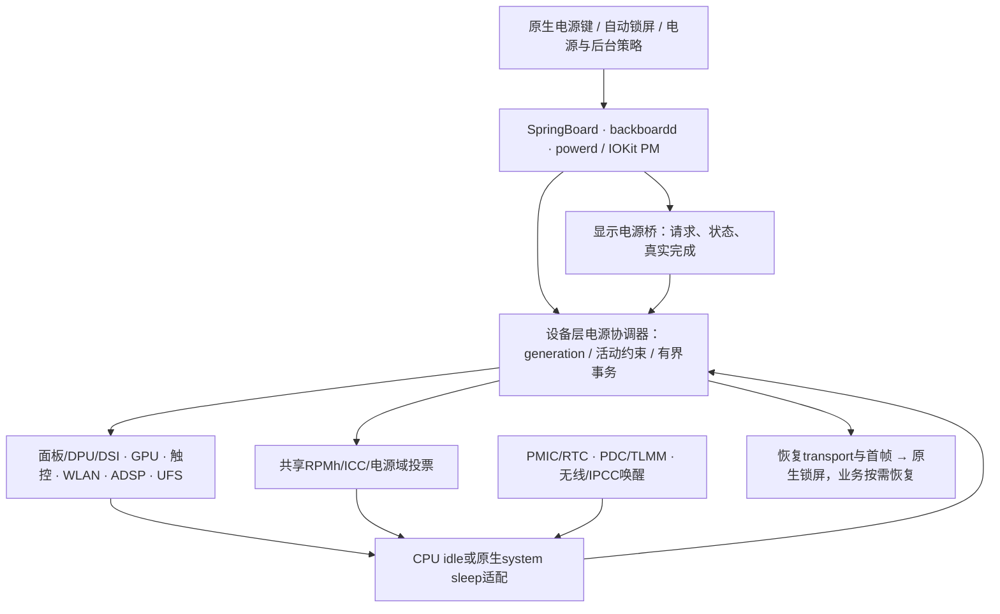

# POWER-02：锁屏、熄屏与整机硬件休眠完整方案

日期：2026-11-07。用户目标是完整支持原生锁屏、自动/手动熄屏，以及屏幕后面的硬件进入适当的低功耗状态并可靠恢复。本文扩展[初版恢复契约](2026-11-07-power-resume-contract.md)，作为当前详细设计；状态和下一动作仍只在 [STATUS.md](../progress/STATUS.md) 维护。

输入为设备源码 `6d074ef09e5777cecfa23612e626ce2c3878153e` 加当前 WIP、本机 live FDT、11-07 Android 只读清单、固定 XNU/主线 Linux 源码。**这是设计与只读调查，不是睡眠实现或设备验收。**本轮没有请求锁屏、熄屏、CPU_OFF、CPU_SUSPEND、SYSTEM_SUSPEND、RTC alarm 写入、重启或 OS 安装。原始输入与源码下载 manifest 留仓库外。

## 1. 完整支持的定义

锁屏、显示状态、设备电源状态和 CPU/系统睡眠必须分别可观察，不能用一个 `screen_off=true` 代替。

| 场景 | 用户可见行为 | 后台硬件要求 |
| --- | --- | --- |
| 亮屏锁屏 | 原生锁屏、通知隐私和正常认证/解锁入口 | 显示工作；没有任务的设备允许 runtime idle，不能强制整机 suspend |
| 熄屏静默待机 | 自动超时或电源键熄屏；按电源键/已支持事件可恢复锁屏 | 面板/DPU/DSI、GPU、触控扫描、UFS、无线和 DSP 按职责进入最低可用状态；AP CPU 长驻留，满足条件后共享域降低功耗 |
| 联网待机 | 显示关闭，保留已验证的网络唤醒/维护能力 | WLAN firmware 节能/必要 offload、真实 wake IRQ；AP 不靠毫秒 polling 维持联网 |
| 后台播放/传输 | 息屏后允许真实业务继续 | 音频/DSP/网络/存储按实际负载保持必要资源，其余域仍可休眠；任务结束后重新评估 |
| 充电、告警和低电量 | 电池/充电/温度真实，必要事件唤醒或阻止深睡 | PMIC/AON 保护及唤醒保留；不能关闭 charger/battery/critical thermal 路由换取低读数 |
| 折叠与外屏 | 后续按真实 Hall/屏幕姿态选屏、休眠和恢复 | 与 FOLD-01 对接，不把折叠必然等同整机睡眠；先固定内屏资格 |

“正常休眠”不是所有电源轨都归零。DRAM 保留、AON/RTC/PMIC、必要的无线/DSP和其他处理器请求需要继续存在。验收对象是本系统负责的设备、AP CPU、共享资源约束和实际 SoC 驻留，不能强制压掉固件/其他处理器的合法投票。

原生锁屏交互纳入本方案；认证与数据保护沿用真实系统能力。当前软件 keybag 不能据此升级为 SEP/硬件密钥保护或生物识别资格，不注入解锁成功，不在唤醒时绕过原生锁屏。

## 2. 当前事实与关键缺口

| 实际代码/输入 | 已核对事实 | 对实现的约束 |
| --- | --- | --- |
| `userland/ui_compat18.c` 的 SpringBoard 初始化、`wake_home` | 写入 `SBDisableAutoDim=true`；启动后请求300秒防休眠、亮屏，并在匹配 ABI 时请求解锁进入主屏 | 先隔离为显式 bring-up 模式；日用模式停止这些动作。旧 CFPreferences 值可能保存在 Data，需定向迁移自己写入的键，而不只删代码或清空整份偏好 |
| `0001` 中 MiniIOMobileFramebuffer user client | `kFBMethodRequestPowerChange` 当前与其他分支一起直接返回成功 | 这是硬件电源操作缺口；必须审查22H374请求 ABI，落到真实异步硬件事务，完成后才报告完成 |
| MiniIOMobileFramebuffer 的 `armVSync/vsync` | 注册后周期通知继续调度，当前没有完整显示电源状态管理 | 熄屏时停止不必要的 presenter/VSync/timer；唤醒时按真实首帧恢复，不伪造扫描/刷新完成 |
| `PongCpuPolicy.h` | 默认启用；线程8 ms一次，负载策略32 ms一次；默认 `pong_l3=1` 投最高L3档 | 日用息屏策略需事件化/定时器合并，并释放本 owner 不再需要的高档请求；降频不等于 CPU power collapse |
| `PongWifiPlatform.cpp` | 主循环 busy时1 ms、idle时5 ms继续 pump；实际 RX 仍为 polling | IRQ驱动收包和无线 wake 是联网深睡的前置；仅延长 polling 间隔不是完整方案 |
| `0002` 触控、`0001` 实体键线程 | 内触控8 ms唤醒检查，实体键16 ms轮询 | 必须接真实触控/PMIC中断及 wake 路由。软件长按重置线程在 CPU 停止时不能充当独立救援 |
| `PongAdsp.cpp` | 注释称无 deadline，但实际服务循环调用 `waitEvents(100)` | 运行此链时仍有100 ms定时唤醒；空闲改事件等待，pending send才保留有界超时。最终电池链不能靠长期关闭ADSP代替 |
| `PongAdrenoPlatform.cpp` / `PongRpmh.cpp` | 保留高档/未知共享 rail minima，现有接口偏向一次 active vote；无完整 sleep/wake aggregate | 先建立 owner/资源图和三态投票，不能直接把 CX/MX/L3 全降零 |
| `ArmCpu::haltCPU/quiesceCPU` 与 XNU `IOCPUSleepKernel` | XNU睡眠线程会对目标CPU对象调用 halt；当前实现直接操作调用所在CPU的timer/GIC，并可能调用当前CPU的CPU_OFF，随后无限WFI | 不能直接触发全局睡眠。需要正确的目标CPU调度退出、idle/shutdown continuation和boot CPU恢复契约；当前存在调用上下文不匹配风险 |
| XNU `cpu_idle` 与设备补丁 | 当前通用路径能WFI，但没有本机深idle的PSCI上下文和共享域协调 | 既有“CPU idle时间”不能证明rail/L3/LLCC关闭；需独立驻留证据 |
| UFS/自定义GPU/WLAN/ADSP owners | 尚无完整配对的 IOKit PM 注册、排空与恢复链 | 现有初始化、stop/reset、故障halt不能直接充当可逆 suspend/resume |
| `PongBootReset.h` | 普通返回有内核pinger/guard与Gunyah watchdog；软件日历用boot epoch和arch timer | 真睡眠时线程可能停止；watchdog与计时器跨目标态的行为尚未知，不能继承普通boot的返回资格 |

这些间隔来自源码，不是实测的唤醒次数、功耗或睡眠失败率。HUD、合成输入、截图、性能探针、HTTPS见证、周期日志及watchdog pinger还需逐项盘点；关闭调试功能不能替代修复生产路径的周期唤醒。

源码入口：[CPU](../../drivers/ArmCpu/ArmCpu.cpp)、[CPU策略](../../drivers/ArmCpu/PongCpuPolicy.h)、[平台](../../drivers/ArmDTPlatform/ArmDTPlatform.cpp)、[UI适配](../../userland/ui_compat18.c)、[Wi-Fi](../../drivers/PongWifi/PongWifiPlatform.cpp)、[ADSP](../../drivers/PongPower/PongAdsp.cpp)、[RPMh](../../drivers/PongPower/PongRpmh.cpp)、[设备XNU补丁](../../patches/xnu-ipados18/0001-pong-darwin24.patch)。

## 3. 本机硬件依据及需要解决的歧义

### 3.1 CPU低功耗与时间

本机只读结果：`/sys/power/state` 为 `freeze mem`，`mem_sleep` 为 `[s2idle] deep`；抽查CPU0/4/7均有启用的WFI和rail-pc，rail-pc累计usage/time非零。本次没有让Android进入全局睡眠，suspend_stats success/fail均为0；不能把“接口列出deep”当成一次整机深睡通过。

live FDT 的 PSCI 为 `arm,psci-1.0`、`method=smc`；当前生成ADT也用SMC。共享代码中的HVC分支说明不等于本机应改用HVC。CPU_ON/RESET2已有证据不推出CPU_SUSPEND/SYSTEM_SUSPEND也可用。

| live DT状态 | 关联 | entry/exit/min residency，µs | 原始PSCI参数 |
| --- | --- | --- | --- |
| silver-c4 / rail-pc | CPU0–3 | 800 / 750 / 4090 | `0x40000004` |
| gold-c4 / rail-pc | CPU4–7 | 600 / 1550 / 4791 | `0x40000004` |
| cluster-d4 / l3-off | 共享cluster-pd | 1050 / 2500 / 5309 | `0x41000044` |
| cluster-e3 / llcc-off | 共享cluster-pd | 2700 / 3500 / 13959 | `0x4100c344` |

前两项有 `local-timer-stop`；arch timer节点同时有 `always-on`。二者不矛盾：计数器继续计时，不代表局部比较器/PPI在失电后还能叫醒CPU。必须核对目标态的AON/broadcast/RTC唤醒机制。

这些数值仅为已提取的候选输入，**不是可以直接执行的SMC参数**。先读PSCI_VERSION、FEATURES(CPU_SUSPEND/SYSTEM_SUSPEND/SET_SUSPEND_MODE)、SMCCC能力和支持的状态格式，再核对本机vendor语义。若没有某个浅层retention状态声明，不自行发明一个state ID。

CPU拓扑还必须分清：XNU的调度E/P分组、3个EPSS频率域和DT里的PSCI共享power domain不是同一张图。last-CPU协调以物理power-domain成员及在线核集合为准，不能按调度cluster ID猜测。

### 3.2 RPMh/TCS：先核对，再写睡眠集

本机apps RSC的DRV2资源为 `0x17a20000`，原始 `qcom,tcs-config` 为：

```text
(2,3), (0,2), (1,2), (3,0), (4,1)
```

当前代码注释使用“SLEEP0–2、ACTIVE3–4、WAKE5–6、fast7”。但按主线binding的 `SLEEP=0/WAKE=1/ACTIVE=2/CONTROL=3`，以及其按DT列序分配slot的方法，上述tuple会解释成ACTIVE0–2、SLEEP3–4、WAKE5–6。vendor还额外声明type4，主线v6.12没有完全等价的五类配置解析。

这是必须解决的**所有权/解释冲突**，还不是已经确认的新寄存器布局或可直接应用的修复。本轮未改任何TCS。active软件触发收到响应，也不能证明该slot适合后续硬件触发的sleep/wake。实现前需取得matching vendor binding/driver、硬件version与运行配置，确认fast-path/control、IRQ ownership和所有client；禁止直接复用当前“active TCS3/4”假设覆盖新的sleep集。

### 3.3 唤醒与驻留资源

- live DT有PDC `0x0b220000` 及本机pin→parent映射；深睡前需把TLMM/PDC/GIC按真实层级接通。不能把PDC pin、GPIO编号和GIC SPI当作同一个编号。
- PMK8350 RTC节点包含RTC `0x6100`、alarm `0x6200`；Android rtc0识别为rtc-pm8xxx，wakeup为enabled。当前XNU没有这个alarm闭环。PMIC IRQ specifier属于SPMI interrupt domain，不能直接注册成同号GIC SPI。
- live DT有cpuss sleep stats、SoC/subsystem sleep stats，可作为后续只读证据来源。需要先确认结构版本、计数器时基、清零/跨重启语义、访问权限；DT地址存在不授权直接随意MMIO。
- 电源键、触控GPIO21、Hall GPIO62以及WLAN/IPCC等各有独立wake路径；当前轮询读键不等于硬件wake。触控手势唤醒、Hall和网络唤醒各自验收，默认先只保留已验证来源。

## 4. 技术路线选择

**主线A：原生策略驱动的设备runtime PM＋分层CPU idle，逐步到SoC深驻留。**

先接通锁屏/显示电源请求，排空设备并停止周期轮询；随后给空闲CPU加入经过验证的PSCI上下文恢复，协调最后一个CPU及RPMh sleep/wake。静默待机时上层任务冻结/让出执行，设备处于低功耗，CPU能长驻留；后台业务发生时短暂唤醒或保持必要域。Android本机默认选s2idle是选择这条尝试路线的依据之一，不是XNU可直接复制Linux控制流的证明。

这条路线最终仍必须证明CPU rail、L3/LLCC和SoC目标态实际到达。只停线程并执行WFI、只得到低CPU占用，或把降频称为深睡，都不满足最终目标。

**备选B：接通XNU原生系统睡眠，再使用固件SYSTEM_SUSPEND。**

如果能力查询、入口/返回ABI、DRAM保留和独立唤醒均成立，沿IOPMrootDomain→设备PM→CPU睡眠路径实现。先修复ArmCpu halt契约和machine resume，不能绕过设备排空直接调IOCPUSleepKernel。SYSTEM_SUSPEND不支持时只否定B，不自动否定A能达到实际低功耗目标；若A始终达不到共享域深驻留，则不能以A的浅层效果宣称完成。

PC/OSI模式按实际固件支持选择，不在首批试验里切换SET_SUSPEND_MODE；模式切换是有状态操作，需要单独设计。Qualcomm私有SIP/SCM路径只在matching vendor接口与权限证据充分时考虑，不扫描未知SMC，也不依赖另一块板的常量。

暂不把冷重启、关闭全部网络、每次重新挂载Data或从Android重新启动，作为“唤醒”的替代实现。休眠到磁盘不纳入这条手机待机主线。

## 5. 原生策略与设备架构



拟在现有PongPlatform24组件内增加zizhan设备层协调器与board inputs，不分叉公共组件身份，不改sibling项目代替设备适配。下面的接口/名字是拟议产物，尚未实现：

- `ZizhanPowerCoordinator`：一张物理资源依赖图、一条串行事务队列；对外状态与真实IOKit PM tree同步，不另起一个相互竞争的假root domain。
- 各owner契约：`prepare → quiesce → commitLowPower → resume → verify`；支持异步完成与明确错误/超时，只有实际硬件完成后才ack。IOKit `PMinit/registerPowerDriver/joinPMtree/setPowerState/acknowledgeSetPowerState`接线需按当前XNU实现核对，不直接重命名启动/stop函数。
- `SleepConstraints`：真实任务、I/O、网络、音频、充电、热状态、debug等约束及到期时间。完整支持的是“约束允许的最深状态”；活动必须有owner、可撤销、不能无期限泄漏。
- `WakeRouter`：唯一wake reason/来源、pending generation、mask/ack规则；来源归属、极性、去抖、跨域路由和重复中断分别管理。
- `VoteManager`：每client的active/sleep/wake需求，父域/带宽/clock/rail按真实规则聚合，兼容外部固件下限；与现有RPMh锁和GPU/ADSP/WLAN全部client统一。
- `PowerEvidence`：低开销事件环和各阶段计数、deadline、rollback原因。稳定测量关闭逐帧/HUD/HTTPS探针；不能为了观测把本应睡眠的设备叫醒。

必须先读取实际IORegistry PM tree、rootDomain存在性、powerd请求和assertions；当前没有源码/日志证据证明这条链已经完整运行。若rootDomain已存在就加入它；若确有缺失，再实现真实平台接线，不复制虚假的睡眠支持属性。

runtime PM与整机事务共用owner契约，但准入不同：单设备idle时允许系统其他业务运行，新请求先取得使用引用、唤醒设备再提交，不能每次UFS idle都冻结全部应用。整机休眠才进行系统级通知、同步和producer收口。恢复代码/栈/页表、阶段日志以及必须在存储恢复前使用的输入需预先驻留；不能在关闭IRQ/clock的关键段临时读APFS、等待可睡眠锁或按首次启动重新分配整个硬件状态。

## 6. 各硬件的完整实现内容

| 子系统 | 进入低功耗 | 唤醒与恢复 | 失败/关键验收 |
| --- | --- | --- | --- |
| 原生锁屏与显示桥 | 移除日用模式的强制亮屏/自动解锁/禁用autodim；定向恢复旧偏好；捕获真实power request的22H374参数与完成ABI | 电源键/系统wake请求回到原生锁屏，保持认证、通知隐私、前后台语义；不会启动时自动解锁 | 不吞请求或直接返回成功；实际UI状态、显示状态、driver状态需对应。手动锁屏、自动超时、快按、重复事件、UI进程重启都覆盖 |
| 面板/DPU/DSI/背光 | 阻止新present并完成在途帧；取得DSI lease；按本机L18 off/sleep命令及原延迟，停止DPU取帧、TE/不必要VSync和PHY/clock，保存模式/DSC/亮度 | 上电/PHY/clock、panel exit-sleep/init、PPS/timing、真实首帧、原亮度及触控；保持原surface对象生命周期 | 亮度0与黑图只是中间控制；不能在DSI DMA仍忙时关域。恢复buffer/映射失败时保留真实错误，不发布假首帧 |
| GPU/GMU/SMMU | 拒绝新submit；以实际CP完成值排空；GMU slumber/idle确认、保存ring/地址空间/固件约束、释放自身clock/rail/ICC票 | 先父域/clock和SMMU/GMU，再ring/HFI/IRQ与client提交；需要context重建时有generation和失效通知 | 不把wait snapshot当完成；不释放硬件仍引用的BO；stop/reset错误路径不冒充可逆休眠。恢复后内容及真实GPU完成均验 |
| 触控与实体键 | 从8/16 ms线程转为IRQ；触控full scan→本机支持的低功耗手势或关闭扫描；保留电源键PMIC路由 | PDC/TLMM/GIC/PMIC真实唤醒，恢复SPI/扫描及HID；消费唤醒事件并避免一按多次/漏release | 第一个阶段只以已验证电源键/定时源唤醒；手势/Hall另验。不能关闭所有clock后还靠读GPIO轮询 |
| WLAN/PCIe/MHI | IRQ驱动pump；实际WMI WoW能力、过滤器及offload配置；冻结/排空host请求，firmware确认后MHI/PCIe进入合适态；配置真实host-wake | 先transport/IOMMU/IRQ，再firmware交接和原生接口；按真实情况恢复关联、租约、路由/DNS或清理重连 | MSI收包、系统wake、WoW支持分开。尚无IRQ时只允许浅层功能或明确“断网待机”试验，不能称联网深睡完成 |
| UFS/APFS | 经真实文件系统同步/PM通知，冻结新I/O和producer，排空所有owner/doorbell/任务，进入适合的UFS device/link Hibern8及clock/rail状态 | 先host/PHY/link/SMMU和command engine，确认ready后重新放行I/O；验证受控文件及fsync持久性 | 低功耗期间不做UFS klog写入；不能只看一个root队列空。root/extents不可移动；Data可正常变化，不能要求整Data hash不变 |
| ADSP/音频/电池 | 空闲事件等待；区分后台播放、battery通道与整DSP；使用真实SMP2P/GLINK/firmware握手，按需降票 | IPCC/wake/通道/intent恢复、真实电池更新；背景播放独立保持必要资源 | 不能把默认ADSP=0当最终完整电源方案；不靠每100 ms轮询维持“存活”，也不强停其他固件client |
| CPU/GIC/timer | per-CPU上下文、IRQ mask与pending race；正确目标CPU退出；依据next deadline/QoS选合法idle state；last-CPU提交共享sleep票 | retention返回与powerdown物理resume入口分开；恢复MMU/栈/每核状态、GICR/GICD/IRQ路由和timer；辅助核重入原调度器 | 不能把CPU_ON首次启动直接当resume，不重复注册CPU；不直接调用当前halt。保留GIC安全组/固件拥有的状态，不能整控制器清零 |
| AON/RPMh/ICC/共享域 | 按board和真实owner建立active/sleep/wake集；active请求排空；在最后CPU退出前锁住并确认资源epoch | 固件/硬件wake集与软件恢复一致，最先恢复合法的父域与transport条件，随后再开放consumer | TCS归属歧义未解前不写sleep集；有未完成请求则退回浅层。DRAM/LLCC保留与掉电时序必须有固件依据 |
| USB/蓝牙/其他传感器/后续modem | 作为同一资源图的client登记runtime状态和wake需求；尚未接通的功能明确不支持 | 插拔、蓝牙、modem paging/SMS、传感器事件以后分别扩展wake并验收 | USB线会引入充电/枚举与唤醒负载；未实现蓝牙/蜂窝不能从WLAN成功推断。不能擅自关掉未知固件/外部域 |

后台HTTPS见证不能常驻在静默功耗测量里。联网待机还需调度自然DHCP T1、租约到期和维护唤醒；不能睡过租约后继续发布旧地址，也不能把主动renew当作自然T1资格。

## 7. CPU/固件尝试方向和时间语义

1. **只读能力清单**：版本、功能返回码、state format、实际SMC conduit、物理拓扑、当前IRQ/wake资源和timer能力。仅调用已知查询接口；不尝试未知函数ID，不切换OSI，不写状态。
2. **先修调度/退出契约**：针对XNU对非当前CPU对象发起halt的场景设计IPI/processor shutdown路径。验证目标核进入自己的退出continuation，调用核继续运行；不能让caller执行目标对象的CPU_OFF。boot核独立处理，不进入无限WFI占住系统睡眠线程。
3. **单核浅层与rail-pc**：WFI作为对照；有声明和能力证据才试retention；rail-pc需要真实保存/恢复入口，不能直接从普通C调用里指望返回。先一颗非boot核，其他核、timer和设备都保持原基线；硬件/软件返回证据齐备后扩大到CPU类别。
4. **共享域逐级**：各核状态、在线核集合、wakeup generation和votes epoch一致，最后一个CPU才处理共享L3/LLCC/RSC；任何核退出失败或新请求出现就取消深度进入。调试插桩验证不能睡到一半丢掉新wake。
5. **平台态选择**：A路线达到实际SoC驻留后，再评估B路线是否提供更低功耗或更完整原生语义。若B被固件拒绝，保留错误与A结果，不把“函数被列出”当系统睡眠通过。

resume入口需要把XNU已有sleep token、per-CPU reset handler、idle thread/context、时间基准及scheduler状态连接到本机物理返回路径；冷启动LowResetVector/CPU_ON仅是可复用材料，不能直接等同恢复。Callee-saved/系统寄存器、MMU/缓存、FP/SIMD/debug等按真实上下文拥有者和XNU契约保存，不能用另板Apple私有寄存器脚本替代。

时间分两类：正常runtime idle期间保持运行时钟；真正system sleep期间按Darwin的absolute/continuous/calendar语义更新，避免重复加睡眠偏移。需要跨目标态实测counter/RTC、timer compare、pending IRQ及过期callout；唤醒后TLS、DHCP、日志时间和原生闹钟都应正确。`always-on`属性不能代替这个验证。

## 8. 原子事务、失败恢复及唤醒竞态

状态机：

```text
Interactive/LockedOn → DisplayOffActive → Preparing(generation)
→ DevicesQuiesced → Entering → Suspended → Resuming → Verify → LockedOn/DisplayOffActive
                           ↘ Abort → 逆序恢复已完成步骤 → 原可用状态
```

`DisplayOffActive`是必要的过渡状态，也允许合法后台业务；不是最终静默深睡合格状态。

- 准备阶段：读取原生约束和deadline，建立completed bitmap、原状态/票据及事务generation；停止新producer，异步通知、排空真实I/O。锁只保护短的状态转换，不能持全局锁等待GPU、APFS或固件，不能在IRQ关闭阶段做可睡眠调用。
- 提交阶段：wake source先配置并确认，清理仅属于自己的旧pending，重新检查新wake generation；共享票与active transactions必须同步。若事件在最后检查与CPU入口间到达，靠pending IRQ/wake协议退出或取消，不清掉新边沿。
- 唤醒阶段：先恢复可执行环境、时钟/IRQ与最小transport，再恢复各consumer；硬件恢复的拓扑逆序与依赖图一致，而非机械倒序重跑所有初始化。用户空间/提交门最后恢复；首帧是一个真实受验收的完成点。
- 中途故障：只回滚已完成的步骤，保留尚在DMA中的资源；如果硬件状态不再可逆，停止该候选并走已验证返回/人工恢复，不假装Awake。真实panic保留。
- 合并事件：连续电源键、自动锁定、充电插拔、Hall、网络和RTC同时到达时按generation合并；旧异步完成不能完成新事务。用户主动wake应取消进入，不被迟到off回调再次熄屏。
- 非常规条件：suspend中UI进程退出、网络固件错误、UFS超时、热/低电量告警、重复IRQ和快速折叠都需要独立回退；不能用重启系统代替恢复成功。

## 9. 独立唤醒与故障返回

正常唤醒、超时返回和最终救援必须区分：

| 角色 | 候选机制 | 开启更深状态前的证明 |
| --- | --- | --- |
| 正常使用 | PMIC电源键；随后RTC、充电/USB、WLAN/IPCC、触控/Hall | 完整IRQ domain、PDC/PMIC极性/ack和实际wake reason，在目标态里能触发，不依赖轮询线程 |
| 有界试验唤醒 | AON定时器或PMK8350 RTC alarm | 保存原alarm/owner，定时事件实际到达、CPU与设备恢复，清理及还原原状态；只读调查本轮未设置alarm |
| 最终救援 | 目标态继续运行的独立watchdog，或已验证外部/PMIC物理恢复 | Gunyah watchdog可能随VM/平台态暂停，需证明；普通线程autoreset、软件长按、USB hub重连均不能自动充当独立复位 |

首次真正平台休眠仍需人在场和已验证救援。先做短时、已知可恢复的单设备/单CPU试验，不能直接无人值守关闭全部CPU。准备中的独立返回不能标记为可用。

当UFS不可访问时，阶段/错误记录留在受管DRAM的有界buffer并按保留契约清cache；恢复存储后再落盘。panic日志路径识别“存储已暂停”，避免在panic里递归等待UFS；跳过不可用的日志写入不能吞掉真实panic/复位。ramoops跨重置仍需检查完整性，不拿损坏/缺失记录证明成功。

普通autoreset pinger、密集探针和USB连接本身会影响驻留与功耗。建立测量profile前先验证AON有界唤醒/独立救援，不能仅去掉所有返回线程来追求漂亮功耗。

## 10. 实施批次与每批验收

这是尝试顺序和依赖，不是另一份动态任务队列。

| 批次 | 具体产出/单变量方向 | 通过条件与停止条件 |
| --- | --- | --- |
| A：只读/模型 | PM tree与原生request ABI清单、wake graph、PSCI/state format、RSC/TCS归属、worker/timer与vote清单；事务模型和故障注入 | 每项都有来源、owner和失败语义；查询不写电源态。TCS/固件/唤醒未知则不执行深态，可继续显示/主机工作 |
| B：锁屏/熄屏 | bring-up开关隔离及偏好迁移；真实显示power request、panel/DPU/DSI/亮度恢复；暂保持CPU/WLAN原策略 | 原生自动/手动锁屏、真实停止扫描/域状态及唤醒首帧/输入；黑图不算通过。首批先固定内屏 |
| C：设备runtime PM | 每轮一个owner：GPU、触控/按键IRQ、ADSP、WLAN IRQ/WoW、UFS；逐个加入依赖图 | drain、低功耗确认、恢复后的真实工作与可逆回退；任何失败退回该owner已验证浅态。优先把总线和IRQ前置准备好 |
| D：共享投票 | 全client active/sleep/wake聚合、ICC/clock/rail owner、RSC sleep集与last-CPU模型 | 无并发active冲突、未知外部票不被降低、enter失败可恢复；未解决TCS归属就停止设备写入 |
| E：CPU上下文 | 正确目标CPU退出、单核已声明深态、物理resume、timer/GIC、共享域last-CPU；按类别逐一扩大 | 实际驻留/唤醒原因、所有核回到调度、时间正确、上下文保持；首次全局休眠有人及独立返回 |
| F：系统整合 | A路线或合格B路线接入原生策略、任务约束、维护唤醒、锁屏恢复 | 相同候选上设备/CPU/资源恢复及功耗成立；锁屏状态不会被错误解锁 |
| G：日用资格 | 静默/联网/背景任务/充电/折叠逐批；短轮→2小时→8小时 | 同输入重复与长时覆盖、数据/网络/时间/温控正确；不从单次温度、一次唤醒或电量百分比推断整机合格 |

建议第一批编码仅做三块：①显式bring-up模式及原生锁屏/显示请求观察；②中立的事务/约束/电源owner模型；③默认关闭的PSCI与wake/TCS只读清单。随后实现面板熄屏恢复。这样可以实测第一段链路，并避免在CPU入口、GPU掉电和UFS暂停同时改动时无法归因。

真实IRQ/wake这一子能力是POWER-02的P1前置；不能因为NET-02的企业认证/SAE/6GHz仍为后续扩展，就把收包IRQ与联网待机一起排到最后。AUDIO/FOLD/BT/MODEM按各自功能资格加入资源图，不能以尚未实现的功能阻塞全部内屏基础工作，也不能将未支持的模式计为“完整手机待机”。

## 11. 证据与最终验收

每轮至少记录：源码/dirty输入、kernel/OS/UI/helper、实际电源profile及探针、供电/USB/网络/屏幕姿态、目标态、所有owner的prepare/ack/drain/resume、last-CPU/IRQ状态、进入/退出时间、硬件驻留、wake reason、回退/返回及存储一致性。PASS/FAIL/SKIP/缺失分列；无日志、无首帧、重启回来不能记恢复PASS。

分三个证据层：

1. **行为层**：原生锁屏、自动熄屏、物理唤醒、亮度/触控/应用内容；原生锁屏保持，业务按真实约束运行。建议每个稳定短场景先10轮，再至少100次混合锁/熄/唤醒，0挂死、0数据错误。次数为拟定验收目标，不是现有成绩。
2. **硬件层**：panel/DPU scan及clock、GPU/GMU idle、UFS device/link、WLAN/MHI、ADSP/IPCC、CPU rail/L3/LLCC/SoC stats和RPMh票。使用前后delta和已验证时基，不把累计非零当本轮驻留。必须看到目标状态和符合场景的长驻留，而非只见软件“suspended”。
3. **功耗层**：与本机Android同场景、同电池区间/温度/信号/连接/姿态对照，至少3个有效窗口，报告时长/样本数、median/p90及测量开销；优先外部供电测量或可信能量/coulomb delta，不能只靠瞬时电流或电量百分比。静默、联网、播放和充电分开定预算。

量化门槛在基线测量后冻结。可先用“静默/联网能量中位数不高于对应Android约1.3倍、无无故周期唤醒、唤醒到可交互p90目标≤1秒”作为工程目标讨论，**不是保证或已有资格**；低功耗状态占比必须先核对统计语义再设阈值，不能为达到目标篡改clock/idle计数。若最终状态/功耗达不到，则仍判未完成，即使UI操作看起来正常。

数据验收覆盖受控文件写入/fsync、休眠中断点、醒后读回、重启后持久性；网络覆盖保持、自然T1、过期/丢网清理和真实重连；定时器覆盖absolute/continuous/calendar、TLS及维护唤醒；故障覆盖prepare失败、wake竞态、丢IRQ/重复IRQ、firmware拒绝、UFS不可用和context丢失。

温控/电池保护仍是长期资格前置：g396只是一次有效温度寄存器读数，没有持续温控。深睡中依赖AON/firmware的保护与告警必须有实际依据，恢复后重验温度/电池。充电负载、热负载及8小时无人值守不能在这些前置未知时提前算通过。

## 12. 来源、未决项与本次结果

固定XNU为 `xnu-11417.140.69` / `43a90889846e00bfb5cf1d255cdc0a701a1e05a4`。关键原生调用链见 [IOCPU.cpp](https://github.com/apple-oss-distributions/xnu/blob/xnu-11417.140.69/iokit/Kernel/IOCPU.cpp)、[IOPMrootDomain.cpp](https://github.com/apple-oss-distributions/xnu/blob/xnu-11417.140.69/iokit/Kernel/IOPMrootDomain.cpp)、[arm64/cpu.c](https://github.com/apple-oss-distributions/xnu/blob/xnu-11417.140.69/osfmk/arm64/cpu.c)。设备修改以本仓库代码/patch为准，不把上游Apple平台睡眠实现直接当zizhan支持。

主线协议/实现参考固定Linux v6.12，下载内容及SHA256在本机sources manifest，可审查以下主源；参考行为不代表其常量适合本机vendor或已经移植：

- [sleep-states](https://github.com/torvalds/linux/blob/v6.12/Documentation/admin-guide/pm/sleep-states.rst)、[device PM](https://github.com/torvalds/linux/blob/v6.12/Documentation/driver-api/pm/devices.rst)：runtime/device/system sleep的区别与恢复通知。
- [PSCI](https://github.com/torvalds/linux/blob/v6.12/drivers/firmware/psci/psci.c)、[cpuidle-psci](https://github.com/torvalds/linux/blob/v6.12/drivers/cpuidle/cpuidle-psci.c)、[PSCI domain](https://github.com/torvalds/linux/blob/v6.12/drivers/cpuidle/cpuidle-psci-domain.c)：能力/格式、上下文、OSI/PC及共享域协调。
- [rpmh-rsc](https://github.com/torvalds/linux/blob/v6.12/drivers/soc/qcom/rpmh-rsc.c)、[rpmh](https://github.com/torvalds/linux/blob/v6.12/drivers/soc/qcom/rpmh.c)、[rpmhpd](https://github.com/torvalds/linux/blob/v6.12/drivers/pmdomain/qcom/rpmhpd.c)：三态投票、last-CPU与sleep/wake set提交；vendor五类TCS配置仍待matching来源。
- [qcom-pdc](https://github.com/torvalds/linux/blob/v6.12/drivers/irqchip/qcom-pdc.c)、[pm8xxx RTC](https://github.com/torvalds/linux/blob/v6.12/drivers/rtc/rtc-pm8xxx.c)、[qcom_stats](https://github.com/torvalds/linux/blob/v6.12/drivers/soc/qcom/qcom_stats.c)：wake层级、alarm和驻留统计审查入口。
- [ath11k WoW](https://github.com/torvalds/linux/blob/v6.12/drivers/net/wireless/ath/ath11k/wow.c)、[MHI PM](https://github.com/torvalds/linux/blob/v6.12/drivers/bus/mhi/host/pm.c)、[UFS Qualcomm](https://github.com/torvalds/linux/blob/v6.12/drivers/ufs/host/ufs-qcom.c)、[GMU](https://github.com/torvalds/linux/blob/v6.12/drivers/gpu/drm/msm/adreno/a6xx_gmu.c)、[ADSP remoteproc](https://github.com/torvalds/linux/blob/v6.12/drivers/remoteproc/qcom_q6v5_pas.c)：逐设备低功耗/恢复尝试的参考，不照搬另一平台初始化。

尚未确认：本机固件CPU_SUSPEND/SYSTEM_SUSPEND和OSI能力、各状态实际准入与返回、vendor TCS编号/fast-path、PM tree实际运行结构、RTC/PDC/PMIC独立wake、WLAN WoW/offload、各域掉电后的context保留、跨睡眠计时、低功耗统计格式及匹配Android功耗基线。这些都是实施阶段的明确验证对象，不以猜测填成已支持。

本次Android采集首次stdin命令30秒超时，没有可用完整/部分输出，已记输入传输失败，不判睡眠失败；改用小范围直接只读命令后获取上述接口和CPU清单。[脱敏审查摘录](../evidence/2026-11-07-power-design-audit.txt)保留来源、实际接口和不确定边界。未执行任何睡眠/唤醒写入。本次成果是完整设计与真实缺口清单，POWER-02仍为IN_PROGRESS；设计文档检查不改变硬件资格。

本轮收口检查：14-area record结构及包含未跟踪文件的改动归属通过，相对文件链接、任务ID唯一性、公开个人绝对路径和 `git diff --check` 通过；runtime源hash未变，无cycle/设备锁。仅修改文档/能力记录，未重跑内核、设备或云端CI；未提交/推送。
