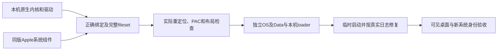

# 11 月 14 日：第一次原生内核启动与当前交接

当前任务以[唯一进度台账](STATUS.md)为准。本文解释两次已经发生的早期原生启动；后续映射数字可能继续变化，不把这里变成另一份任务队列。发布检查点的实际桌面候选仍有544项导入未闭合，未生成可安装集合。

## 现在能开机到哪里

新的22G100/arm64e内核已经在MIX Fold 2上实际执行到虚拟内存、zone分配器和C++类注册。**还不能进入桌面**，也没有安装新的原生系统到手机。旧v23、canonical OS370、旧Data和完整备份保留。

两次都使用临时`fastboot boot`、同一个独立threaded-starts诊断内核，不接OS/Data卷，UFS写关闭；native EFI在交接前准备的watchdog提供早期返回。两次分别约58秒和60秒回fastboot，取回ramoops后回Android，`boot_completed=1`均通过。第二轮后又只读核对旧v23整窗、root/klog extent、manifest与135项备份，结果一致。

| 轮次 | 唯一变化 | 实际取得的进展 | 仍未完成 |
| --- | --- | --- | --- |
| native18-early-diag-1114a | 首次正确threaded-starts格式的原生诊断 | Darwin24、9728MiB/4KiB内存、VM/zone初始化、新console和v92诊断标记；有界返回与日志取回 | typed-zone配额超过32槽，真实assert停止；没有桌面 |
| native18-early-diag-1114b-kt120 | 同内核仅加`kt_fixed_zones=120` | 跨过前一assert，继续到C++类注册；新fault的可辨LR落在`OSMetaClass::postModLoad`范围，有界返回 | 缺失retained组件父类依赖；没有平台/存储/显示/用户态资格 |

ramoops在watchdog返回后有位翻转。原始日志与hash保留在本机证据树，不能按猜测修写成一份“干净日志”。上表只采用可与实际源码、符号及独立主机复现交叉核对的事实，不宣称全部寄存器、FAR或panic PC精确可读。

## 这次真的修掉了什么

第一次触发的是`kalloc_type_create_zones_fixed`中的真实断言：一个大小类的signature zones、type zones和共享槽总数不能超过固定32槽数组。

新增工具读取实际编译产物的1,321个类型视图，按原代码排除data-only/VM项后剩1,172项，再用实际XNU的预算policy在ASan/UBSan下重放。默认预算260使48字节类得到16＋16＋1＝33槽，准确复现越界前的断言条件。已有预算参数120得到6＋6＋1＝13槽，第二轮实机确实继续向后执行。断言、类型隔离与真实分配器都保留。

这是一项**source-only诊断输入的已验证参数修正**。完整fileset加入原厂组件后，类型分布也会变，必须重新计算；不能直接称为完整系统的分配器修复。

## 为什么fork了Pong还需要接线

fork保留的是代码历史和实现。启动集合还需要把Apple组件对内核的调用接到我们这次编出来的实际函数与数据地址；这些地址不是Git中的固定硬件常量。

旧22H374输入保留约6,116个带地址的导出符号，工具可以直接按名字把Apple组件调用接到本机内核。新22G100采用kernel collection，已检查的295个entry符号表均为空；符号集里虽有5,995个KPI名字，却没有对应地址。Apple在最终集合中已经把名字链接成地址，单纯更新Pong源码不能把被Apple去掉的名字表恢复出来。

因此“新版Pong没有内核接线”不是准确解释。原版Pong有实际原生启动记录，并有公开mapper；它的迁移记录还明确提到按源码语义、RPC、PAC和数据引用把113项人工审阅到零，但完整本机审阅表没有随公开配方提供。本机已实际复现原版Pong完整内核链接；同工具、同Apple输入对原Pong full和zizhan full得到639/640项研究缺口，639项全部共同，说明主体问题在共享的名字恢复和绑定材料，不能归罪于小米驱动。

硬件代码仍有真实差异：本机内存、面板、触控、UFS、GPU、电源与Wi-Fi必须使用zizhan资料。完整Pong参考kernel带外板参数，只用于主机对照，不会在MIX Fold 2上运行。

## 为什么现在还不能进入桌面

目前诊断内核缺少原厂APFS、存储、图形等组件，且内置驱动有指向这些真实父类的绝对依赖。第二轮推进到C++注册后的故障与这个已知边界相符。把缺失父类伪造成空对象、忽略断言或返回成功，不能产生可用的系统。

桌面候选还需要完整的链路：

接线工作已经从猜函数顺序转向实际证据：KDK独立kext保留具名导入和认证stub；确认调用者的类、方法、完整指令及其它操作数后，可以从准确调用位置恢复API身份。API身份正确允许源码因合法配置而有不同实现，不要求先在主机证明整个allocator与Apple实现逐指令相同；运行行为仍由后续设备试验验证。

研究图或候选名字本身不能用于启动。此前实际发现过三参数UPL接到两参数包装、布尔唤醒接到数量接口；这些错误会直接破坏运行。最新门槛的回归负控制又发现一次“API身份与仅操作等价”分类错误，失败输出已拒绝，分类修正后两个实际错误API控制均在资格表输出前拒绝。失败证据保留，不能用一个更小的缺口数字掩盖。

## 接续和验收

全天手机操作授权有效，今天目标仍是新原生系统真实进入桌面。当前数量和下一执行项见[台账](STATUS.md)及[当日完整对照记录](2026-11-14-upstream-control-day.md)；机器进程、候选hash、实际安装与回退细节在仓库外handoff。

后续先完成真实API/data绑定和fileset机械闭合，核对完整组件的类型配额、重定位与PAC，再给独立OS/Data安排新设备轮次。旧系统、旧Data和回退不作为临时试验的代价。已知不完整的source-only full诊断不再原样重启；编译成功、发送成功或这两次早期内核运行均不等于桌面验收。
